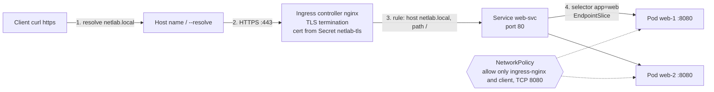
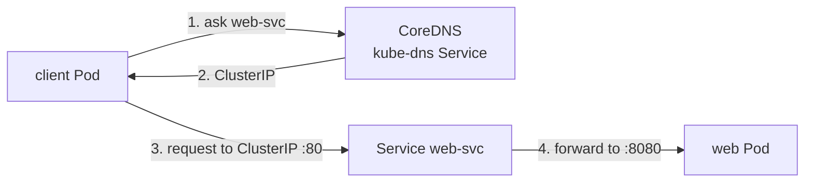

# Netlab: Routed Application on Kubernetes (minikube + Calico)

A small web app (`http-echo`, 2 replicas) reachable from outside through
Ingress with TLS, protected by NetworkPolicy.

## Request-flow diagram



Inside the cluster, a Pod finds the Service by name:



## Request flow in words

1. Client sends an HTTPS request for `netlab.local`.
2. Ingress controller receives it on port 443 and decrypts it (TLS termination), using the certificate in Secret `netlab-tls`.
3. It reads the Ingress rule: host `netlab.local`, path `/` goes to Service `web-svc`, port 80.
4. The Service uses its selector (`app=web`) and the EndpointSlice to choose one Pod, and sends the request to the Pod's port 8080.
5. NetworkPolicy allows this traffic because it comes from the `ingress-nginx` namespace on port 8080.
6. The Pod replies, and the reply goes back the same way.

## Files

| File | Purpose |
|---|---|
| deployment.yaml | 2 web Pods, label app=web, port 8080 |
| service.yaml | ClusterIP Service web-svc, port 80 to targetPort 8080 |
| ingress.yaml | Routing rule for netlab.local with TLS |
| deny-all.yaml | Default deny for incoming traffic |
| allow-ingress-controller.yaml | Allow ingress-nginx to reach web Pods on 8080 |
| allow-client.yaml | Allow the client Pod to reach web Pods on 8080 |

The TLS key and certificate (`tls.key`, `tls.crt`) are not committed.

## Concepts practised

- **CoreDNS:** the cluster DNS server. Pods get its address in `/etc/resolv.conf`. Full Service name: `<service>.<namespace>.svc.cluster.local`.
- **EndpointSlices:** the list of Pod IPs behind a Service, built from the Service selector.
- **Ingress and controller:** the Ingress is the rule file, the controller (nginx) applies the rules.
- **TLS termination:** the controller decrypts HTTPS, then sends plain HTTP inside the cluster. Self-signed certificate stored in a `tls` Secret.
- **NetworkPolicy:** default deny, then allow only the Ingress controller and the client Pod.
- **Pod connectivity:** Pod to Service by name, Pod to Pod by IP, Pod to external site (example.com) works because only incoming traffic is restricted.

## Failures simulated

| Failure | What I saw | How I found it | Fix |
|---|---|---|---|
| Wrong selector | 503 from Ingress, connection refused | `describe svc`: Endpoints is none, EndpointSlice empty | Selector back to app=web |
| Bad target port | Timeout (NetworkPolicy dropped port 9090) | `describe svc` TargetPort 9090 vs container port 8080 | targetPort back to 8080 |
| Failed DNS lookup | NXDOMAIN for a wrong name, timeout when CoreDNS was scaled to 0 | `nslookup`, CoreDNS Pods | Correct the name, scale CoreDNS back up |
| TLS error | Certificate verify error, fake default certificate | Controller logs: Secret not found | secretName back to netlab-tls |

## Commands to run

```bash
minikube start --cni=calico
minikube addons enable ingress
kubectl create namespace netlab
kubectl apply -f deployment.yaml -f service.yaml
kubectl create secret tls netlab-tls -n netlab --cert=tls.crt --key=tls.key
kubectl apply -f ingress.yaml
kubectl apply -f deny-all.yaml -f allow-ingress-controller.yaml -f allow-client.yaml
curl --cacert tls.crt --resolve netlab.local:443:$(minikube ip) https://netlab.local
```

